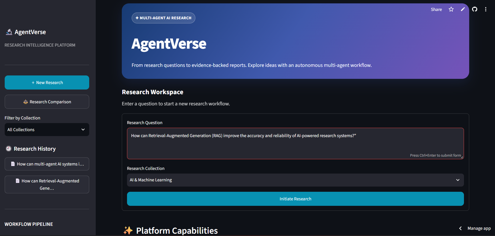
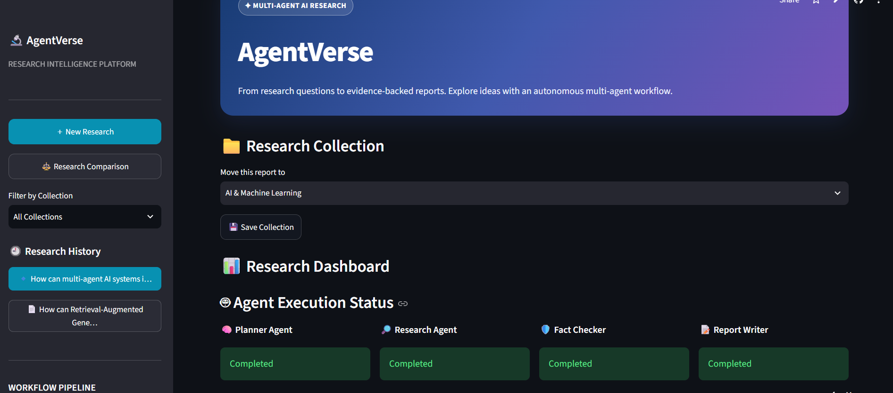
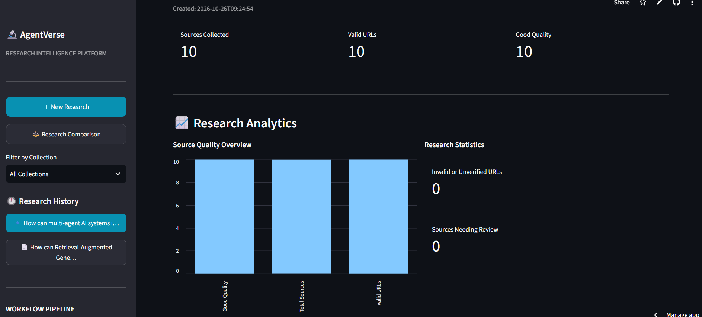
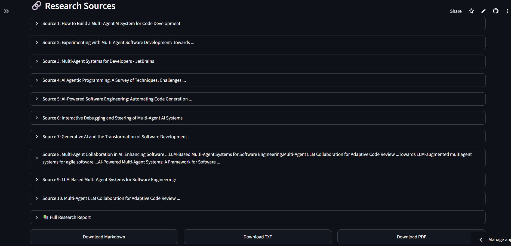
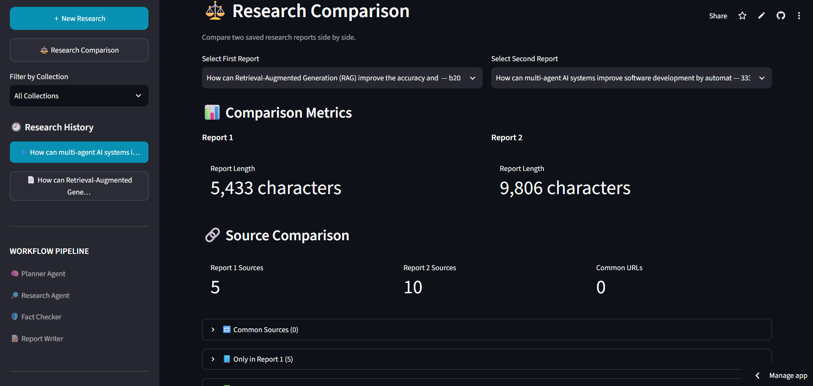

AgentVerse — Multi-Agent AI Research Intelligence

  <strong>From Research Questions to Structured, Evidence-Grounded Insights.</strong>

  An AI-powered research workflow built with LangGraph, Streamlit, and Gemini to coordinate research, evaluate sources, and generate structured reports.

  <a href="https://agentverse-ujuppsjzjkh6en4losoqvp.streamlit.app/">🚀 Live Demo</a>
  &nbsp; • &nbsp;
  <a href="https://shitsukendu.github.io/AgentVerse/">💻 GitHub Repository</a>

  <em>Research smarter. Verify sources. Turn information into insight.</em>

---

📌 Project Overview

AgentVerse is a multi-agent AI research application designed to transform open-ended research questions into organized, source-backed reports through a structured workflow.

Instead of relying on a single AI response, AgentVerse separates the research process into specialized stages: planning, web research, source-quality assessment, and report generation. These stages are coordinated through LangGraph, while a Streamlit interface provides an interactive environment for conducting and reviewing research.

The goal is to make AI-assisted research more organized, traceable, and useful for learning, technical exploration, and knowledge discovery.

🖼️ Application Preview

### Main Dashboard

### Research Workflow  

 

### Research Analytics

### Source Quality  

### Research Comparison & PDF Export

---

✨ Key Features

- Multi-Agent Research Workflow — Divides research into specialized tasks instead of relying on a single undifferentiated response.
- Intelligent Task Planning — Organizes research questions into smaller, manageable tasks.
- Automated Web Research — Retrieves relevant web results for research tasks.
- Source Quality Assessment — Evaluates collected sources using URL validity, available evidence, and quality indicators.
- AI-Generated Research Summary — Uses Gemini to help summarize research findings.
- Structured Research Reports — Combines findings and source information into a readable report.
- Research History — Stores research records locally for later review.
- Research Collections — Supports organizing saved research into collections.
- Source Comparison — Compares two reports and identifies common URLs and report-specific sources.
- PDF Report Export — Generates downloadable PDF comparison reports.
- Interactive Streamlit Interface — Provides a practical UI for conducting and reviewing research.
- Modular Architecture — Keeps planning, research, fact-checking, and report-writing responsibilities separate.

«Important: Source-quality assessment is a heuristic evaluation, not a guarantee that every claim is factually correct. Always review important findings against their original sources.»

---

🧠 Multi-Agent Architecture

AgentVerse uses a graph-based workflow to coordinate its research stages.

flowchart TD
    A([Research Question]) --> B[Planner Agent]
    B --> C[Research Agent]
    C --> D[Fact Checker Agent]
    D --> E[Report Writer Agent]
    E --> F[Structured Research Report]
    F --> G[Streamlit Interface]
    G --> H[History and Comparison]
    H --> I[PDF Export]

Agent Responsibilities

Agent| Responsibility
Planner Agent| Breaks the research question into actionable research tasks.
Research Agent| Searches the web and collects relevant source information.
Fact Checker Agent| Assesses source validity, evidence availability, and quality indicators.
Report Writer Agent| Organizes findings into a structured report and can generate an AI-assisted summary.

The workflow is coordinated using LangGraph, with shared research state passed between stages.

---

⚙️ Technology Stack

Category| Technologies
Language| Python
User Interface| Streamlit
Agent Orchestration| LangGraph
Generative AI| Google Gemini API
Web Search| "ddgs"
Environment Configuration| "python-dotenv"
Dependency Management| "uv"
Data Persistence| SQLite
Report Generation| ReportLab
Testing| pytest-compatible Python tests

---

🏗️ Project Structure

AgentVerse/
│
├── app.py
├── main.py
├── database.py
├── pyproject.toml
├── uv.lock
├── .python-version
├── .gitignore
├── README.md
│
├── src/
│   ├── agents/
│   │   ├── planner_agent.py
│   │   ├── research_agent.py
│   │   ├── fact_checker_agent.py
│   │   └── report_writer_agent.py
│   │
│   └── tools/
│       └── web_search.py
│
├── test_fact_checker.py
├── test_research.py
│
└── outputs/  # Locally generated research reports

The structure above highlights the main project components. Actual files and folders may differ as the project evolves.

---

🚀 Getting Started

Follow these steps to run AgentVerse locally.

Prerequisites

- Python version compatible with ".python-version"
- Git
- "uv" package and project manager
- A Google Gemini API key for Gemini-powered features
- Internet access for web research

1. Clone the Repository

git clone https://github.com/shitsukendu/AgentVerse.git
cd AgentVerse

2. Install Dependencies

Install "uv" if it is not already available, then run:

uv sync

This installs dependencies defined by the project configuration and lockfile.

3. Configure Environment Variables

Create a ".env" file in the project root:

GEMINI_API_KEY=your_gemini_api_key_here

Replace the placeholder with your own API key.

Security notice: Never commit ".env" or expose API keys in source code, screenshots, logs, or public documentation.

4. Launch the Application

uv run streamlit run app.py

Open the local URL displayed in your terminal to access the application.

---

🔍 How It Works

1. Submit a research question through the application.
2. Plan the research into smaller tasks.
3. Collect web sources relevant to the generated tasks.
4. Assess source quality using available URL and evidence indicators.
5. Generate a structured report with findings and source information.
6. Review and compare research using the application's history and comparison features.
7. Export comparison results as a PDF when needed.

The quality of the final report depends on search availability, source relevance, the information retrieved, and the performance of the AI model.

---

📊 Research Comparison

AgentVerse includes a report comparison workflow for examining two research reports side by side.

The comparison interface can present:

- Source counts for each report
- Common source URLs
- Sources unique to the first report
- Sources unique to the second report
- Downloadable PDF comparison reports

A common URL is counted when the comparison logic recognizes the same URL in both reports. Different URLs do not necessarily imply that two reports disagree on their findings.

---

🧪 Testing

Run the available test files from the project root:

uv run python test_fact_checker.py

uv run python test_research.py

These commands execute the project's test scripts. Review their output to determine whether the checks pass in your environment.

---

🔐 Security & Responsible Use

- Keep API keys and credentials in environment variables.
- Do not commit ".env", virtual environments, local databases, or private research records.
- Review external sources before relying on their claims.
- Treat generated summaries as AI-assisted research, not as verified ground truth.
- Check the applicable website terms and usage restrictions when collecting web content.
- Use appropriate attribution when referencing external material.

---

🛣️ Roadmap

Potential future improvements include:

- [ ] More robust URL canonicalization and duplicate-source detection
- [ ] Claim-level evidence verification
- [ ] Source credibility signals and transparent scoring
- [ ] Improved research traceability and citations
- [ ] More export formats for research reports
- [ ] Additional visualization and analytics
- [ ] More comprehensive automated tests
- [ ] Deployment monitoring and graceful handling of search failures

Roadmap items represent potential improvements and are not claims about currently implemented functionality.

---

👨‍💻 About the Developer

Name: SUKENDU SHIT

Role: Computer Science & Engineering Student | AI/ML Enthusiast

Interests: Multi-Agent Systems, Generative AI, Retrieval-Augmented Generation (RAG), AI Research Workflows, and Intelligent Applications.

GitHub: https://github.com/shitsukendu

LinkedIn: https://www.linkedin.com/in/sukendu-shit-825203283/

---

🤝 Contributions & Feedback

Suggestions, bug reports, and improvements are welcome.

If you find an issue or have an idea that could improve AgentVerse, feel free to open a GitHub Issue or submit a Pull Request.

---

📄 License

No license has been specified yet.

If you intend to distribute this project as open source, consider adding an appropriate license file and updating this section.

---

  <strong>AgentVerse</strong> 
  <em>Turning research questions into structured, source-aware knowledge.</em>

